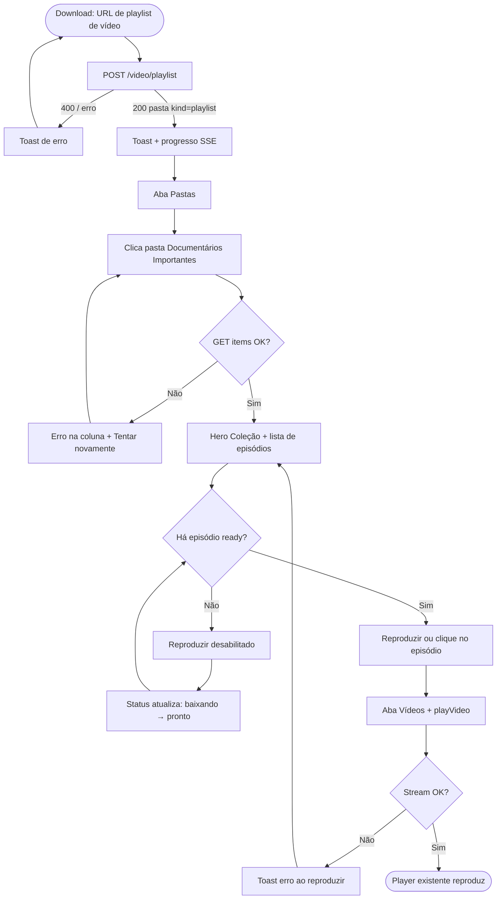
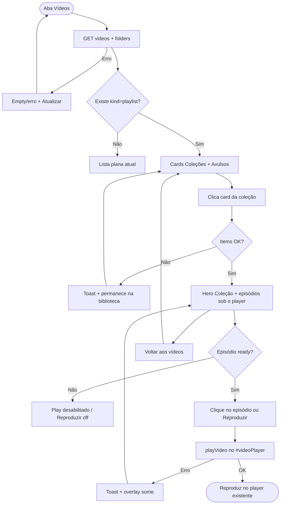
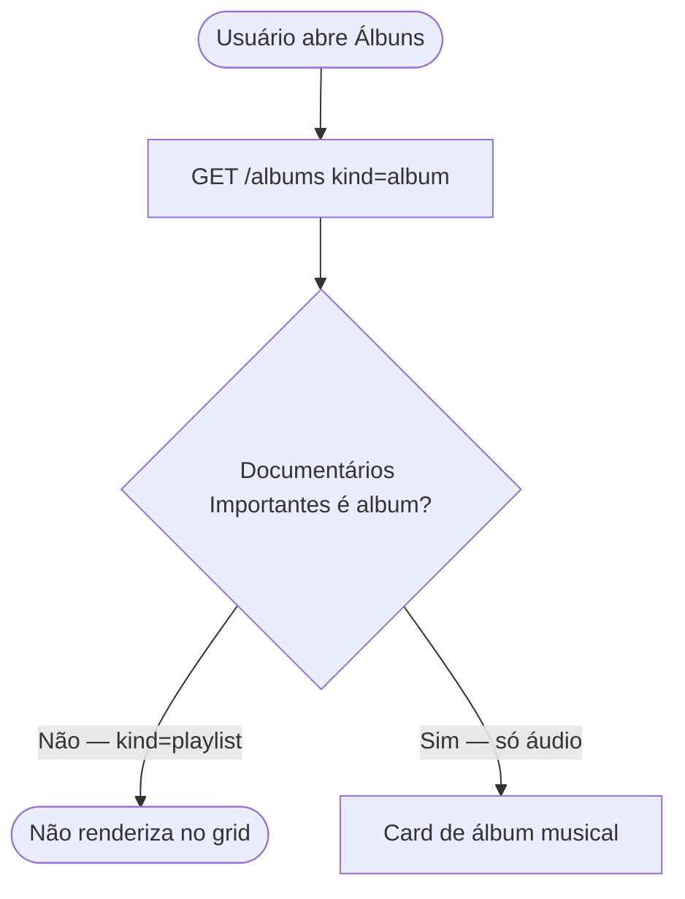
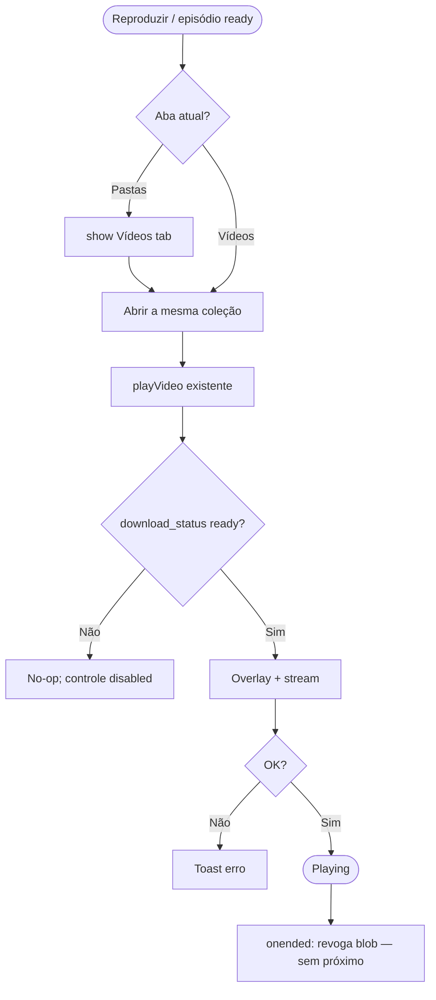

# User Flows — Coleções de vídeo (v1)

**Feature:** Collection/series view for `kind=playlist` folders
**Chrome label:** **Coleção** (hero/cards). Pastas folder meta may still say Playlist.
**Play:** existing `#videoPlayer` on the Vídeos tab. **Reproduzir** = first `download_status=ready`. No new queue.

---

## Flow 1: Download playlist → Pastas collection → play

### Entry Points

- Download tab → **Download de Vídeo** → paste YouTube playlist URL (`list=` without `v=`) → **Baixar Vídeo**
- User already has folder *Documentários Importantes* (`kind=playlist`) in Pastas

### Happy Path

1. User submits a playlist URL on Download.
2. System `POST /video/playlist`, creates folder (`kind=playlist`, `cover_url`, `description: Playlist`), enqueues videos.
3. Toast: playlist enfileirada; **Downloads em Andamento** shows per-item progress (existing).
4. User opens **Pastas**. Folder *Documentários Importantes* is in the list (icon `playlist`; meta may show Playlist).
5. User clicks the folder (not edit/delete).
6. System shows collection chrome in the items column: cover, eyebrow **Coleção**, title, `N vídeos`, **Reproduzir**, ordered episodes with status.
7. User clicks **Reproduzir** (or a ready row).
8. System switches to **Vídeos**, keeps this collection open, calls existing `playVideo` on the first ready episode.
9. `#videoPlayer` loads; overlay then playback; `#currentVideoTitle` updates.

### Alternative Paths

- **If some episodes still downloading:** Hero shows `N vídeos · M prontos`. **Reproduzir** uses the first **ready** in order (not the first row if that row is pending). Downloading rows show the ring badge.
- **If no episode is ready yet:** **Reproduzir** disabled; tooltip “Nenhum vídeo pronto ainda”. User can wait; SSE/poll updates rows in place.
- **If user clicks a specific ready episode:** That episode plays (not necessarily the first).
- **If user clicks Voltar / breadcrumb Raiz:** Collection chrome closes; folder list as today.
- **If user clicks play on a generic (non-playlist) folder item:** Unchanged: `playItemFromFolder` → Vídeos + `playVideo`.

### Error Paths

- **Playlist URL rejected (400):** Existing toast with `detail`; no folder.
- **Enqueue fails:** Existing toast “Erro ao enfileirar playlist”; Pastas unchanged.
- **Folder items fail to load:** Error in items column + **Tentar novamente**; left folder list stays.
- **Play fails:** Overlay hides; toast “Erro ao reproduzir vídeo”; user stays on collection.
- **401:** Existing `authenticate()` flow.

### Exit Points

- **Success:** Watching in `#videoPlayer` on Vídeos with collection still open.
- **Abandon:** Voltar / another tab. Downloads continue in background.
- **Failure:** Toast + stay; no navigation to Álbuns.

### Diagram

---

## Flow 2: Vídeos tab grouping → open collection → play episode

### Entry Points

- User opens **Vídeos** after playlist downloads (or mid-download).
- User arrived from Pastas **Reproduzir** (collection already open).

### Happy Path

1. User opens **Vídeos**. Existing player stays at the top (idle or last video).
2. System partitions `list-downloads`:
   - `folder_id` ∈ folders with `kind=playlist` → **Coleções** cards
   - no folder or `kind=folder` → **Avulsos** (`yd-media-item` as today)
3. User sees a card for *Documentários Importantes* (16:9 cover, title, `N vídeos`).
4. User clicks the card.
5. Library list is replaced by collection view: **Voltar aos vídeos**, same hero + ordered episodes. Player **does not unmount**.
6. User clicks episode 3 (ready).
7. `playVideo` runs in the player above; row 3 marked playing.

### Alternative Paths

- **Zero collections:** No Coleções heading; flat list only (today’s UI).
- **Zero avulsos:** Avulsos section hidden.
- **Search:** Cards whose title **or** any episode title matches stay; avulsos filtered as today. No matches → existing empty search.
- **Partial downloads:** Card count includes all episodes; opening shows mixed statuses; play only ready.
- **Reproduzir in this view:** First ready episode; no tab switch (already on Vídeos).

### Error Paths

- **List fetch fails:** Existing empty list + console/toast; refresh button.
- **Opening collection fails:** Toast “Erro ao abrir coleção”; stay on grouped library.
- **Click not-ready episode:** No navigation; play control disabled.
- **Play error:** Same overlay + toast as today.

### Exit Points

- **Success:** Episode playing; collection view visible under the player.
- **Voltar aos vídeos:** Grouped library again; player keeps current src if playing.
- **Abandon:** Other tab; player may keep playing (existing behavior).

### Diagram

---

## Flow 3: Álbuns exclusion (negative path — P0)

Pastas must not treat this folder as an album: **no** disc play-album control that calls `openAlbumById`. Click opens **Coleção**, never Álbuns.

---

## Shared play sub-process

---

## Edge cases

| Case | Behavior |
|------|----------|
| Folder exists, 0 videos | Hero + **Nenhum vídeo nesta coleção**; **Reproduzir** disabled |
| First playlist item dead / error | Skip for **Reproduzir**; first **ready** wins; error row stays visible |
| Generic folder with videos | Avulsos (flat), not a collection card |
| Audio album folder | Álbuns only (unchanged); not a Coleção |
| Mid-download open | Collection allowed; rows live-update like Vídeos |
| Cover missing | Icon fallback `bi-collection-play` |
| Search matches episode, not title | Parent collection card still shown |

---

## Out of scope (do not flow)

- Auto-play next episode
- Sticky mini-player / shuffle / repeat
- Opening this folder in Álbuns
- New **Coleções** tab
- Converting playlist → album
